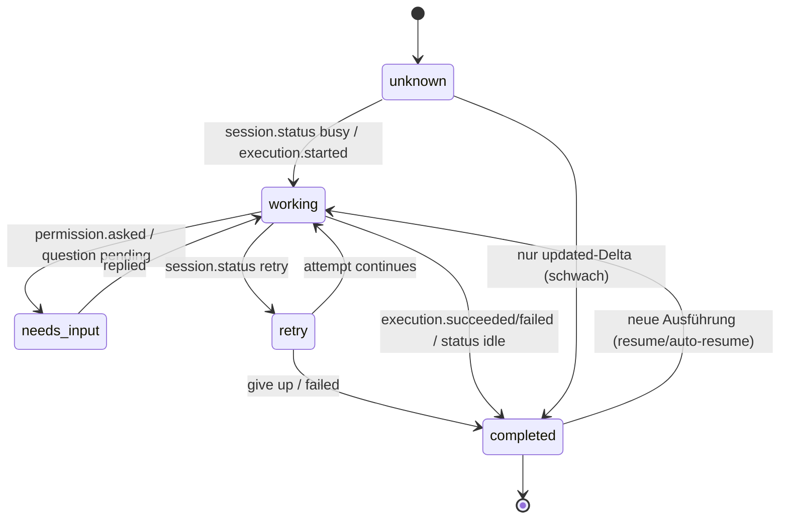
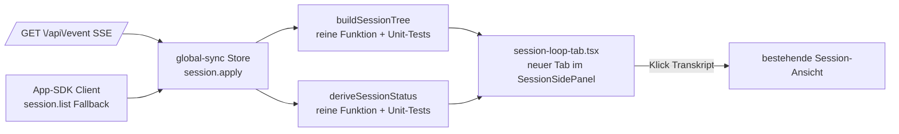

# Session-Loop-Tab (opencode-App, rechtes Side Panel) — SPEC v1.0

**Datum:** 2026-10-16
**Status:** FREIGEGEBEN (tplan, Score 10/10)
**Repo:** ~/workspace/OpenFlow (Fork, packages/app @opencode-ai/app 1.18.17)

## 1. Problemstellung

Der geschlossene Agent-Loop (Main-Session → Subagent-Sessions → Ergebnisse → NEXT MOVE) ist in der opencode-App unsichtbar: Die Home-Ansicht filtert Kind-Sessions bewusst aus (`home-session-index.ts:135`) und gruppiert nur zeitlich (`today/yesterday/older`); ein Statusmodell jenseits `unread/loading/open` existiert nicht (`home-sessions-controller.tsx:302-318`). Ziel: Hierarchie + Live-Status + NEXT-MOVE-Sichtbarkeit als neuer Tab im rechten SessionSidePanel — das Pendant zur Claude-Code-Side-Rail.

## 2. Architektur-Entscheidung

- **Neuer Tab „Loop"** im SessionSidePanel (V2-Designzweig primär: `session-side-panel.tsx:548-693`, Content-Slot `:721-727`; Legacy-Zweig registrieren, minimal ausgestatten).
- **Read-only aus vorhandenem global-sync-Store** (`@/context/sync`): Jedes Session-Objekt trägt `parentID` (SDK v2, live gemessen). Kinder der aktuellen Root-Session = Subagent-Baum.
- **Status-Ableitung als reine Funktion** über Event-Namen, die die App bereits konsumiert: `session.status` (busy/idle/retry), `session.execution.succeeded/failed` (`server-session.ts:965-966`), `session.updated`. Event-Mapper akzeptiert zusätzlich Fork-Namen (`session.next.step.ended`, `session.idle`) → funktioniert gegen beide Server-Welten.
- **Fallback-Fetch** über den App-SDK-Client (`session.list`, liefert `parentID`, live gemessen) beim Tab-Öffnen und bei unvollständigem Store — bringt Auth mit, kein eigener fetch.
- **Keine Server-Änderungen**, keine neuen Endpoints, keine Migration.

## 3. Use Case Map

**Happy Paths**
- H1 Tab öffnen → Baum: aktuelle Root-Session + Subagent-Kinder eingerückt (Agent, Modell, relatives Alter, Status-Badge).
- H2 Live: Subagent startet/endet → Badge working → completed, ohne Reload (SSE-Store).
- H3 Subagent braucht Input (Permission/Question pending) → Gruppe „Needs input" oben.
- H4 Klick auf Kind-Session → Transkript dieser Session öffnen.
- H5 Retry-Zustand sichtbar (Badge retry + Versuch-Zähler).

**Edge Cases (mit Lösung)**
- E1 Store hält Kind-Sessions nicht → Fallback `session.list` via SDK; danach Store-Reconcile.
- E2 Question-Events fehlen auf dem Ziel-Server (Messung: `question.v2.asked` 0× im v2.0.31-Binary, `question.list` not found) → „needs input" zunächst permissions-basiert; Questions ergänzen, sobald der Store sie führt (P1-Sondierung entscheidet).
- E3 Keine Status-Events → Badge „unbekannt", niemals fake-idle; `time.updated`-Delta als schwaches Signal (grauer Punkt).
- E4 >50 Subagent-Sessions → Cap 50 + Zähler, neueste zuerst.
- E5 Session während Anzeige gelöscht → Store-`apply` (`session.deleted`) räumt Zeile raus.
- E6 App gegen Fork-Server :4096 statt V2-Sidecar → Event-Mapper (siehe 2.) fängt Fork-Namen ab.
- E7 Session kompaktiert (`time.compacting`) → Badge „compacting".
- E8 Root-Session ohne Kinder → freundlicher Empty-State mit Hinweis auf `subagent`-Tool (kein toter Bereich).

## 4. State Machine (Session-Status im Tab)

Vergessene Zustände, die die Machine aufgedeckt hat: `unknown` (kein Fake-idle), `retry` (SessionRetry existiert serverseitig, `status.ts:39-48`), `compacting` (DB-Feld `time_compacting`).

## 5. Komponentenarchitektur

Grenzen: Tab liest nur (Store + SDK-GET), schreibt nichts, keine Server-Änderung. Neue Dateien: `session-loop-tab.tsx`, `loop/tree.ts`, `loop/status.ts` + Tests. Angefasst: `session-side-panel.tsx` (Registrierung), `helpers.ts` (panelTabs), `en.ts` (i18n).

## 6. Verifizierte Fakten (Messungen 16.10.2026)

| Fakt | Quelle |
|---|---|
| `parentID` in Session.Info, `agent`, `model`, `cost`, `tokens`, `time` | `packages/opencode/src/session/session.ts:224-244`; live: `opencode api session.list` |
| SidePanel rechts, Tabs, Content-Slots | `packages/app/src/pages/session.tsx:2254/2306`, `session-side-panel.tsx:315,548-693,721-727`, `helpers.ts:31-72` |
| App-SSE-Store + session.apply | `server-sdk.tsx:279`, `server-sync.tsx:531-543` |
| App konsumiert `session.execution.succeeded/failed` | `server-session.ts:965-966` |
| `permission.request.list` live OK | Messung: `{"location":…,"data":[]}` |
| `session.status`/`question.list` not found auf angesprochenem Server; `question.v2.asked` 0× im v2.0.31-Binary | Messung 16.10. |
| Kein Status-Feld in DB/Info — Status nur Events/In-Memory | `sql.ts:22-66`, `status.ts:26-48` |
| Home filtert Kinder raus | `home-session-index.ts:135` |
| Tests: `bun test --conditions=solid` (unit), `test:browser`, `typecheck: tsgo -b` | `packages/app/package.json` scripts |

## 7. Security / Datenschutz

Lokale UI (localhost), keine neuen Datenflüsse nach außen, Auth läuft über den bestehenden SDK-Client. Keine persönlichen Daten in Logs. — irrelevant/erfüllt.

## 8. Teststrategie

| ID | Typ | Was | Ein/Ausgabe | Prio |
|---|---|---|---|---|
| T-01 | Unit | `buildSessionTree` | 5 Sessions (2 Kinder, 1 verwaist) → Baum; Verwaiste unter Root-Cluster | MUSS |
| T-02 | Unit | `deriveSessionStatus` | Sequenzen busy→asked→replied→succeeded → working/needs_input/working/completed; leer → unknown | MUSS |
| T-03 | Unit | Cap + Retry | 60 Sessions → 50 + Zähler; retry-Event → retry badge + attempt | MUSS |
| T-04 | Browser | Loop-Tab-Render | gemockter Store → 3 Gruppen, Badges, Einrückung | MUSS |
| T-05 | Smoke | typecheck + build | `tsgo -b` 0 Fehler, `vite build` ok | MUSS |
| T-06 | Live-Smoke | echte Subagent-Session in App dev | Badge-Wechsel sichtbar (Screenshot) | SOLL |

Ausführen: `cd packages/app && bun run test:unit && bun run test:browser && bun run typecheck`. Akzeptanz: T-01..T-05 grün.

## 9. Implementierungsphasen

1. **P1 Sondierung:** grep `app/src` nach pending question/permission-Handling (event-reducer, server-session) → entscheidet E2 (Questions ja/nein). *(15 min, lesend)*
2. **P2 Reine Funktionen** `loop/tree.ts`, `loop/status.ts` + Unit-Tests T-01..T-03. *(abhängig von P1)*
3. **P3 UI** `session-loop-tab.tsx` + Registrierung V2/Legacy + `helpers.ts` + `en.ts`. *(abhängig von P2)*
4. **P4 Absicherung** Browser-Test T-04, typecheck, build. *(abhängig von P3)*
5. **P5 Ship** Commit + Push origin dev; danach visueller Live-Smoke (Playwright) im Haupt-Repo. *(abhängig von P4)*

## 10. Risiken + Kill Criteria

| Risiko | Mitigation | Kill-Kriterium |
|---|---|---|
| Ziel-Server emittiert `session.status` nicht | Doppelquelle: Events + `session.updated`-Delta + execution.* | Bleibt alles stumm → Dauerzustand „unbekannt"; Feature trotzdem nutzbar (Hierarchie+Alter) — kein Abbruch |
| Fork-Upgrade verwirft Patch | Patch-Fläche minimal (3 neue Dateien + 2 Registrierungen + i18n) | Konflikt >3 Dateien beim Rebase → Tab-Datei isoliert neu registrieren |
| tsgo strict bricht | Im Task fixen, kein Bypass, kein `any`-Hammer | — |
| Store hält keine Kinder UND `session.list`-Fallback < nutzbar | Cap + Empty-State E8 | K1: wenn beide Quellen <5 Sessions liefern → Scope auf „aktuelle Session + Hinweistext" reduzieren |
| Browser-Test-Mocking zu aufwendig | Unit-Tests decken Logik; Browser-Test schlank halten | K2: Harness-Mock scheitert → T-04 durch visuellen Smoke ersetzen (dokumentiert) |
| Legacy-Zweig frisst Aufwand | Legacy: nur Tab-Registrierung + einfache Liste | K3: Legacy >50% Aufwand → nur V2-Zweig, Legacy-Registrierung ohne Farben |

## 11. Kosten

Lokal, Dharma-Flatrate — entfällt.
