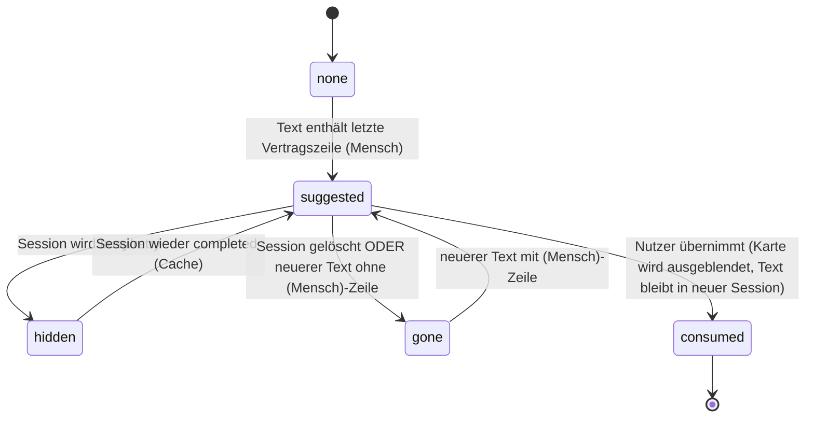
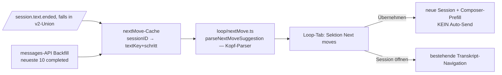

# Session-Loop-Tab Stufe 2 — NEXT-MOVE-Queue — SPEC v1.0

**Datum:** 2026-10-16
**Status:** FREIGEGEBEN (tplan, Score 10/10)
**Basis:** docs/SESSION_LOOP_TAB_SPEC.md (Stufe 1, umgesetzt in 5cb220634)
**Repo:** ~/workspace/OpenFlow (packages/app)

## 1. Problemstellung

Stufe 1 zeigt Hierarchie + Status. Was fehlt ist der Claude-Code-Follow-up-Moment: Subagenten enden mit „NEXT MOVE (Mensch): <Schritt>" — genau die Schritte, die auto-resume bewusst NICHT übernimmt (R17-Freigabeliste: alles Unsichere ist (Mensch)). Diese Vorschläge versickern im Transkript. Stufe 2 zeigt sie als startbare Items im Loop-Tab.

## 2. Architektur-Entscheidung

- **Parser:** `loop/nextMove.ts` — NEU, nachgebaut nach dem Kopf von `~/.config/opencode/plugins-shared/naechster-schritt.ts` (`vertragsZeile`/`VERTRAG_KOPF`, Zeilen 35–66): VERTRAG_KOPF-Regex 1:1 übernehmen (Quellenkommentar + Datum; Quelle der Wahrheit bleibt plugins-shared). Nur Kopf-Parsing: letzte Vertragszeile im Text → `{kategorie: "selbst"|"mensch"|"keiner"|"" , schritt}`. KEIN Sicherheitsnetz (keinSchritt/sichererSchritt) — Anzeige ≠ Resume-Entscheidung; der Mensch liest mit.
- **Datenquelle zweigleisig:** (a) live: `session.text.ended`-Event liefert Assistant-Text (Beleg: auto-resume.ts:85–86, `data.text`, Dedup-Key textID) — NUR abonnieren, wenn der Event-Typ in der v2-SDK-Union existiert (P0 prüft `packages/sdk/js/src/v2/gen/types.gen.ts`; Stufe-1-Fund: `session.execution.*` war NICHT in der Union). (b) Backfill: messages-API (Anker `server-session.ts:81` messages(input), `server-session-v2-reducer.ts:9` SessionMessageInfo) für Sessions, die vor Tab-Öffnung endeten — nur neueste 10 completed Sessions, letzte assistant message, kleiner limit, Cache pro sessionID (Dedup wie auto-resume: textID/textKey).
- **UI:** Sektion „Next moves" im Loop-Tab (unter Needs input, vor Working). Karte: Session-Kurzlabel (Agent/Titel), Schritt-Text (3 Zeilen, expandierbar), relatives Alter. Aktionen: **[Übernehmen]** + [Session öffnen].
- **[Übernehmen] = bewusst KEIN Auto-Send:** (Mensch)-Schritte sind per Definition die unsicheren Klassen (Geld/Produktion/Versand/Löschen — R17). 1 Klick öffnet eine NEUE Session im selben directory mit dem Schritt als vorbereiteten Composer-Text; Absenden macht der Nutzer (Enter). Wenn P0 keine Prefill-Mechanik findet → Kill K1: Stufe-2a (Anzeige + „Kopieren" + Session öffnen), Autostart bleibt Folgehebel.

## 3. Use Case Map

**Happy Paths**
- H1 Subagent endet mit „NEXT MOVE (Mensch): PR mergen, nachdem Thomas geschaut hat." → Karte erscheint (live oder nach Refresh) in „Next moves".
- H2 [Übernehmen] → neue Session, Composer zeigt „PR mergen, nachdem Thomas geschaut hat." — Nutzer drückt Enter.
- H3 [Session öffnen] → Transkript der vorschlagenden Session (bestehende Navigation aus Stufe 1).
- H4 Session läuft wieder (auto-resume/Neuauftrag) → ihr Vorschlag verschwindet (Status ≠ completed).

**Edge Cases (mit Lösung)**
- E1 Kategorie „selbst" oder „keiner" → keine Karte (selbst = auto-resume-Territorium; keiner = nichts).
- E2 Keine Vertragszeile im Text (alter Vertrag, Prosa) → keine Karte, kein Raten.
- E3 Text ohne neue Vertragszeile, aber neuem Abschluss (Re-Reply) → Cache vergleicht textKey; unverändert → keine Neu-Anzeige.
- E4 >10 Vorschläge → neueste 10, Zähler wie Stufe-1-Cap.
- E5 Doppelte Vorschläge (Session antwortet mehrfach mit (Mensch)) → nur der LETZTE Vertragszeilen-Schritt pro Session (1 Karte pro Session).
- E6 Session gelöscht → Karte raus (Store-apply wie Stufe 1, E5 dort).
- E7 Veralteter Vorschlag: Session wieder busy → Karte ausgeblendet; completed wieder → Karte zurück (aus Cache).
- E8 nextMove-Text sehr lang → 3 Zeilen Clamp + Expand; Titel-Attribut mit Volltext.
- E9 messages-API liefert älter-zuerst → letzte assistant message bestimmen, nicht erste.

## 4. State Machine (Vorschlag je Session)

Vergessene Zustände, die die Machine aufdeckt: `hidden` (busy overlay), `gone` (neuerer Text ersetzt alten Vorschlag), `consumed` (Übernahme darf die Karte nicht doppelt zeigen).

## 5. Komponentenarchitektur

Dateien: NEU `loop/nextMove.ts` + `nextMove.test.ts`; ERWEITERT `loop/controller.ts` (Cache+Backfill+Events), `session-loop-tab.tsx` (Sektion+Aktionen), `en.ts` + 61 Locales (~8 Keys), evtl. `test-browser/session-loop-tab.test.ts` (neue Cases).

## 6. Verifizierte Fakten

| Fakt | Quelle |
|---|---|
| Vertragsformat + tolerant Parser-Kopf (VERTRAG_KOPF, vertragsZeile, Trenner-Regeln) | plugins-shared/naechster-schritt.ts:35–66 |
| (Mensch) = bewusst nicht automatisch (R17-Freigabeliste; unsichere Klassen Geld/Konto/Produktion/Versand/Löschen) | naechster-schritt.ts:95–114, 196–240 |
| `session.text.ended` liefert Assistant-Text (`data.text`, textID-Dedup) | plugins/auto-resume.ts:85–86, 427–433 |
| v2-SDK-Union kann Event-Namen fehlen (Stufe-1-Fund: session.execution.*) | Stufe-1-Review; P0 prüft text.ended |
| Messages-Zugriff in App: server-session.ts:81; Store-Shape SessionMessageInfo | App-Sondierung (dünn — P0 vertieft) |
| i18n-Parity: jeder en-Key in jeder Locale, 62 Dateien | parity.test.ts:105 (Stufe-1-Fix) |
| Beispiel-Vorschläge realer Agenten („PR mergen, nachdem Thomas…", „Abstimmen mit dem Security-Team…") | naechster-schritt.ts:7–9 (Abnahme R14 live) |

## 7. Security

Kein Auto-Send (Begründung §2). Vorschlagstext ist Anzeige, keine Ausführung. Neue Session im selben directory (kein Directory-Sprung). Keine neuen Netz-Ziele. DSGVO irrelevant (lokale UI).

## 8. Teststrategie

| ID | Typ | Was | Priorität |
|---|---|---|---|
| T-01 | Unit | parseNextMoveSuggestion: (Mensch)-Zeile → Vorschlag; selbst/keiner/ohne → null; Footer (⎯⎯ … ⎯⎯) abgezogen; Backtick-Zeile, Fettdruck, Überschrift+Absatz, Gedankenstrich-Trenner | MUSS |
| T-02 | Unit | letzte Vertragszeile gewinnt (E5): zwei (Mensch)-Zeilen → nur letzter Schritt | MUSS |
| T-03 | Unit | Controller-Cache: gleicher textKey → keine Neu-Anzeige; neuer Text ohne Vertragszeile → Karte weg (gone) | MUSS |
| T-04 | Unit | Backfill-Auswahl: E9 letzte assistant message; Cap 10 (E4) | MUSS |
| T-05 | Browser | Sektion rendert Karten (Mock-Store+Events); [Übernehmen] navigiert/prefillt ODER kopiert (je P0); E7 busy blendet aus | MUSS |
| T-06 | Smoke | bun run test:unit + test:browser + typecheck-Filter (0 neue in eigenen Dateien) | MUSS |

## 9. Implementierungsphasen

- **P0 Sondierung (lesend, ~30 min):** (1) `session.text.ended` in `packages/sdk/js/src/v2/gen/types.gen.ts`? (2) messages-API-Shape exakt (server-session.ts:81 consumer + SDK-Client-Methode; letzte assistant message bestimmen); (3) Neue-Session+Prefill-Mechanik in der App (grep prefill/draft/initial/composer set; New-Session-Flow) → entscheidet [Übernehmen] vs. K1.
- **P1** `loop/nextMove.ts` + T-01/T-02.
- **P2** Controller: Cache, Event-Abo (falls P0.1 grün), Backfill, E7-Logik + T-03/T-04.
- **P3** UI-Sektion + Aktionen + i18n (Skript, alle Locales).
- **P4** T-05 Browser-Test, volle Suiten, typecheck-Filter.
- **P5** Ship (Parent): Merge, Push. Abhängigkeiten streng linear P0→P1→P2→P3→P4.

## 10. Risiken + Kill Criteria

| Risiko | Mitigation | Kill-Kriterium |
|---|---|---|
| Parser-Drift zu plugins-shared | Regex 1:1 + Quellenkommentar; echte Beispiele als Tests | Nur Anzeige betroffen — kein Abbruch |
| messages-API-Shape unklar/anderes | P0 klärt vor P2; Fallback sync-Store (`sync().data.message`) | K2: API unbenutzbar → Backfill nur über live-Events (Karten erst ab Tab-Öffnung) |
| Keine Prefill-/Neue-Session-Mechanik | P0.3 | K1: Stufe-2a — Anzeige + Kopieren + Öffnen; [Übernehmen]-Autostart Folgehebel |
| Fetch-Sturm bei vielen Sessions | nur neueste 10 completed, Cache, kein Polling | — |
| i18n-Parity rot | Skript wie Stufe 1 | — |
| tsgo strict | Fix im Task, kein any, Baseline-Fehler unangetastet | — |

## 11. Kosten

Lokal, Dharma-Flatrate — entfällt.
